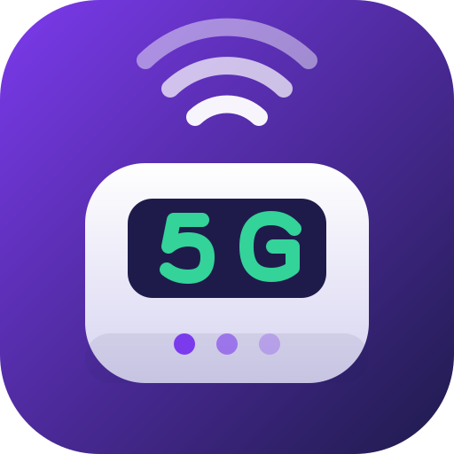

  

  
  

<h1 align="center">Netgear Nighthawk M6 for Home Assistant</h1>

Monitor signal, daily and monthly mobile data usage, and control a Netgear Nighthawk M6 5G/LTE hotspot over its local web API.

Built and tested on a Nighthawk M6 (MR6450). No cloud account, YAML or
external scripts are needed.

## Features

- **Traffic that survives reconnects:** daily, monthly and lifetime download/upload totals. The device only counts the current data session, so the integration accumulates the deltas itself. See [Traffic counters](docs/setup.md#traffic-counters).
- **Signal and network:** LTE and 5G signal quality (RSRP, RSRQ, SINR, RSSI), bands, operator, network type, cell ID, roaming, and which uplink is active when the hotspot fails over.
- **Controls:** airplane mode, mobile data, data roaming, UPnP, VPN passthrough, power mode, and a restart button.
- **Device metadata:** serial number, firmware, hardware and modem versions, Wi-Fi and Ethernet MAC addresses, plus IMEI, SIM serial number (ICCID), IMSI and phone number as opt-in diagnostic sensors.
- **UI configuration:** config flow with reauthentication, reconfiguration and a polling-interval option. Startup never waits for the device. See [Setup](docs/setup.md).

## Install

Use the Marketplace badge above on Home Assistant 2026.11 or later to add this
repository as a custom integration. On older versions (2026.9 or later), add
it as a HACS custom repository of type **Integration**. Install and restart
Home Assistant. The badge does not imply a public catalog listing. For manual
installation, copy `custom_components/netgear_m6/` into Home Assistant's
`custom_components/` directory and restart.

## Quick start

1. Add **Netgear Nighthawk M6** under **Settings → Devices & services → Add integration**.
2. Enter the hotspot's address and the admin password of its web interface.
3. Check the traffic and signal sensors, then enable any identifier sensors you want.

## Documentation

| Topic | Description |
|-------|-------------|
| [Setup](docs/setup.md) | Entities, traffic counters, polling and the single-session behavior |
| [Local protocol](docs/protocol.md) | How the web API logs in, reads state and changes settings |

## License

[GPL-3.0-or-later](LICENSE).
